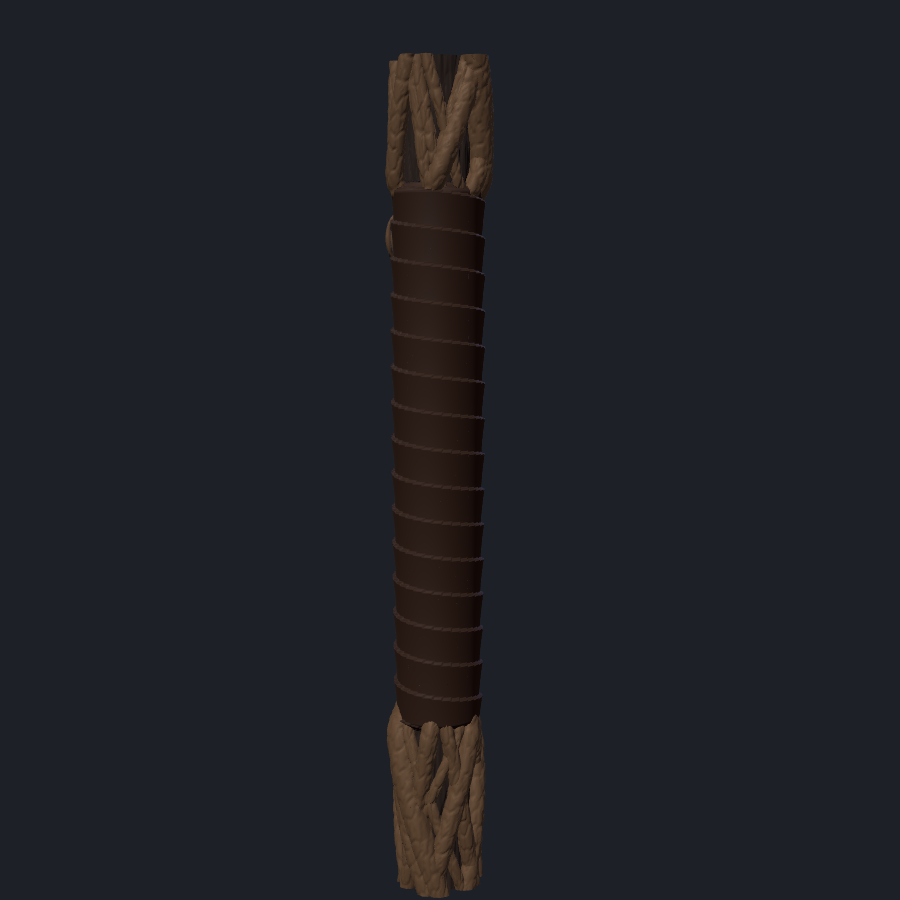

# Bâton de la Guggen

Bâton d'environ **1,82 m** : un fût droit en bois sombre, enlacé de lianes qui se croisent
et s'évasent en racines au pied, une poignée en cuir enroulé avec un médaillon, des éclats
de cristal sertis, et en haut un bouquet de cristaux violets et verts tenu par les lianes,
éclairé par une bougie LED. Conçu pour une **Prusa XL 5 têtes** (plateau 360 × 360 × 360 mm).

| Tête | Poignée | Pied | Bâton complet |
|---|---|---|---|
|  |  |  |  |

## Principe

- Un **tube alu Ø16 mm** passe à l'intérieur et donne la solidité. Les tronçons imprimés
  s'enfilent dessus et se collent. Paroi d'au moins 3,5 mm autour du tube, vérifiée par le script.
- **Fût en bois sombre** Ø30 mm, veiné de longues fentes fines.
- **14 lianes** (dont 3 épaisses) s'enroulent dans les deux sens, se croisent, se décollent
  par endroits, et s'évasent en racines au pied. Elles plongent sous la poignée et ressortent.
- **Poignée en cuir** (230 mm) : lanière enroulée en hélice, chaque tour recouvrant le précédent,
  avec un médaillon ovale (couleur des lianes).
- **4 éclats de cristal violet** sertis dans le fût.
- **Bouquet** : 30 cristaux (un grand central de 14 cm, trois couronnes de plus en plus inclinées),
  70 % violets et 30 % verts. Chaque liane se dédouble en haut et s'entrelace entre les cristaux.
- **Bougie LED** logée en haut du col, sous les cristaux. Le bouquet s'emboîte sur le col et se
  bloque avec 2 vis.
- **3 pendentifs** (2 violets, 1 vert), percés pour une cordelette, à nouer à la poignée.

## Têtes et filaments

| Tête | Filament | Pour |
|---|---|---|
| T1 | PLA brun très foncé / brun-noir mat | Fût en bois |
| T2 | PLA brun moyen, idéalement soie bronze ou cuivre | Lianes et médaillon |
| T3 | PLA ou PETG **translucide violet** | Cristaux violets |
| T4 | PLA ou PETG **translucide vert** | Cristaux verts |
| T5 | PLA noir ou brun foncé mat | Cuir de la poignée |

## Fichiers (`stl/`)

Chaque pièce = plusieurs STL à charger **ensemble** dans PrusaSlicer (même origine, rien à aligner).

| Pièce | Fichiers | Taille (mm) | Têtes |
|---|---|---|---|
| Fût 1 (pied) | `fut_1_bois` + `fut_1_lianes` + `fut_1_cristaux_violets` | 81 × 77 × 350 | T1, T2, T3 |
| Fût 2 | `fut_2_bois` + `fut_2_lianes` | 48 × 47 × 350 | T1, T2 |
| Fût 3 | `fut_3_bois` + `fut_3_lianes` + `fut_3_cristaux_violets` | 47 × 45 × 350 | T1, T2, T3 |
| Fût 4 (poignée) | `fut_4_bois` + `fut_4_lianes` + `fut_4_cuir` | 49 × 46 × 350 | T1, T2, T5 |
| Col | `tete_1_col_bois` + `tete_1_col_lianes` + `tete_1_col_cristaux_violets` | 64 × 70 × 185 | T1, T2, T3 |
| Bouquet | `tete_2_bouquet_bois` + `_lianes` + `_cristaux_violets` + `_cristaux_verts` | 130 × 134 × 223 | T1, T2, T3, T4 |
| Pendentifs | `pendentifs_violets` (2) et `pendentif_vert` | petits | T3, T4 |

## À acheter

| Article | Quantité |
|---|---|
| PLA brun très foncé (T1) | 1 bobine de 1 kg (~0,6 kg utilisés) |
| PLA brun / soie bronze (T2) | 1 bobine de 1 kg (~0,7 kg utilisés) |
| Translucide violet (T3) | 1 bobine (~120 g utilisés) |
| Translucide vert (T4) | 1 petite bobine ou un reste (~50 g) |
| PLA noir ou brun foncé mat (T5) | un reste ou 1 petite bobine (~150 g) |
| Tube alu rond Ø16 mm, paroi 1 mm | 1 barre de 2 m, à recouper à **1,52 m** |
| Bougie LED chauffe-plat Ø38 mm max, **blanche ou RGB avec télécommande** | 1 lot (une orange rendrait les cristaux violets ternes) |
| Vis à bois / aggloméré 3,5 × 20 mm | 2 |
| Colle époxy 2 composants rapide | 2 tubes |
| Cordelette cuir ou cirée Ø1 à 1,5 mm | 1 m (pour les pendentifs) |
| Patin caoutchouc adhésif Ø40-50 mm | 1 (sous le pied) |
| Facultatif : jus brun-noir + vernis mat | pour faire ressortir le relief |

## Réglages PrusaSlicer (Prusa XL 5T, buses 0,4 mm)

- Charger les fichiers d'une pièce **ensemble** → « Oui » à « objet à plusieurs parties »
  → attribuer chaque partie à sa tête. Ne pas redimensionner ni tourner.
- Couches **0,20 mm** pour le fût et le col, **0,15 mm** pour le bouquet.
- **3 périmètres**, 4 couches pleines dessus/dessous, **gyroïde 10 %**.
- Jointure **alignée**. **Bordure (brim) 8 mm** : les tronçons font 35 cm de haut.
- Tour de nettoyage activée, avec sa bordure.
- **Supports organiques** :
  - fût et col : depuis le plateau seulement (le bas des racines et quelques lianes décollées) ;
  - bouquet : **partout** (les lianes du haut se recourbent au-dessus du vide) ;
  - supports et interface en T1, espace en Z 0,2 mm.
- **Cristaux** (réglage par partie) : 2 périmètres, **0 % de remplissage** pour qu'ils restent
  creux et laissent passer la lumière.
- Pendentifs : debout, base en bas, sans support (le trou de 2 mm passe en pont).
- Estimation : **~60 à 80 h** d'impression au total. Poids du bâton ≈ 1,5 kg avec le tube.

## Montage

1. Couper le tube à 1,52 m, ébavurer.
2. Enfiler les tronçons du pied (`fut_1`) au haut (`fut_4`), en collant chaque jointure à l'époxy,
   et tourner chaque tronçon jusqu'à ce que les lianes se raccordent.
3. Emboîter le col sur le haut du tube (douille de 120 mm), coller.
4. Poser la bougie dans le logement en haut du col, emboîter le bouquet, visser les 2 vis
   dans les trous latéraux (ne pas coller : il faut pouvoir changer la pile).
5. Nouer les pendentifs à la poignée avec la cordelette.

## Finition

Un jus brun-noir très dilué sur le fût et les lianes, essuyé tout de suite, fait ressortir
les fentes et l'écorce. Un brossage à sec léger (beige-gris) sur les lianes. Vernis mat,
en masquant les cristaux.

## Modifier le bâton

Tout est généré par `generer_baton.py` (Python 3, `pip install numpy scipy trimesh manifold3d`).
Les réglages sont en haut du fichier : longueur, diamètre du tube et du fût, nombre de lianes,
position de la poignée. Change `GRAINE` pour obtenir un autre bâton.
