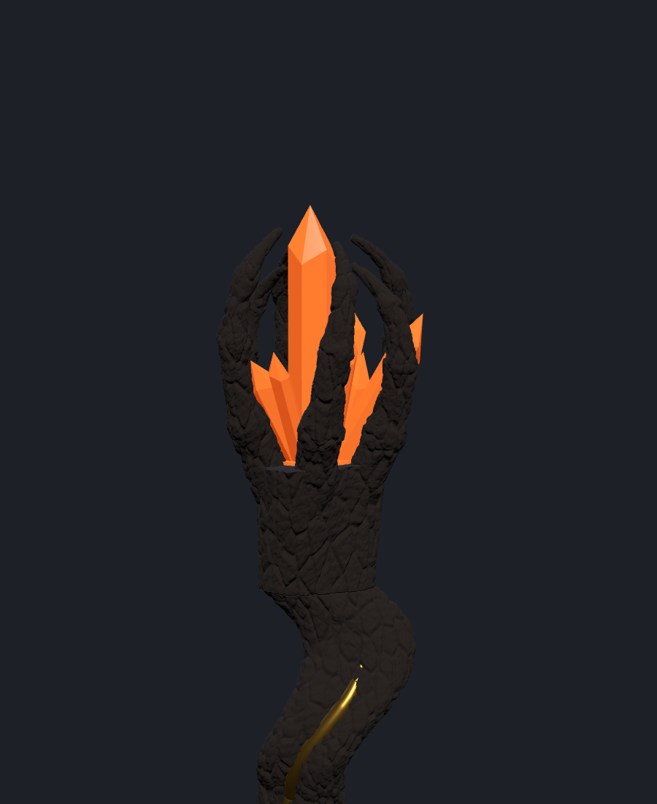
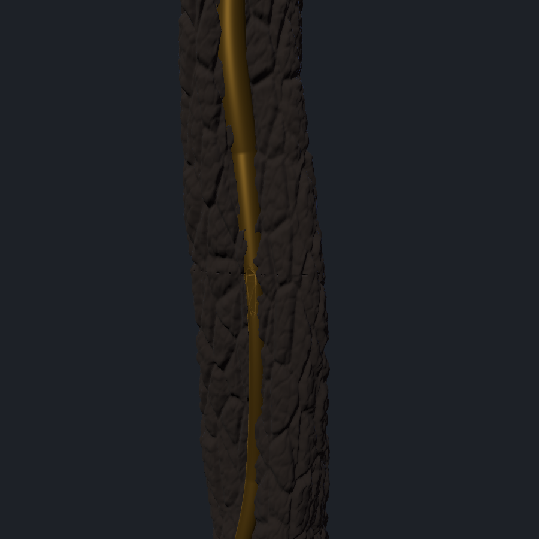
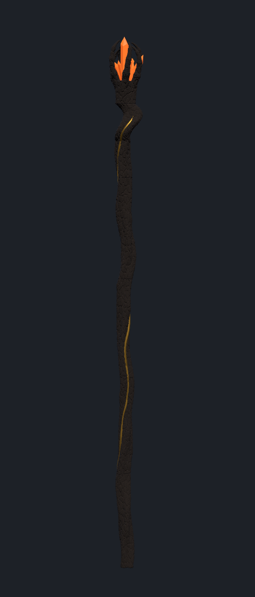

# Bâton de la Guggen

Bâton d'environ **1,90 m** en bois calciné et tordu, parcouru d'une veine dorée, avec en haut
une main noueuse qui enserre des cristaux éclairés par une bougie LED orange.
Conçu pour une **Prusa XL multi-têtes** (plateau 360 × 360 × 360 mm).

| Tête | Écorce | Bâton complet |
|---|---|---|
|  |  |  |

## Principe

- Un **tube alu (ou fibre de verre) Ø16 mm** passe à l'intérieur et donne la solidité.
  Les tronçons imprimés s'enfilent dessus et se collent. Un bâton tout en plastique
  casserait au premier choc.
- Le tube est droit, mais l'extérieur ondule : la paroi est automatiquement épaissie
  là où le bois s'approche du tube (au moins 3,5 mm partout, vérifié par le script).
- La texture d'écorce (plaques et fissures) est continue d'un tronçon à l'autre.
- La **veine dorée** est une pièce séparée, logée dans le sillon de l'écorce : à imprimer
  dans une 2e couleur (PLA soie or ou cuivre).
- Les **cristaux** sont imprimés en même temps que la main, dans une 3e couleur (PLA
  translucide orange ou fumé) : les doigts les enserrent, ils ne s'enlèvent pas.
- La bougie LED se loge dans le haut du col. On retire la main pour l'allumer.

## Fichiers (`stl/`) et filaments

Chaque pièce multi-couleur = plusieurs STL à charger **ensemble** dans PrusaSlicer.

| Pièce | Fichiers | Taille (mm) | Outils |
|---|---|---|---|
| Fût 1 à 4 (1 = pied) | `fut_N_ecorce.stl` + `fut_N_veine.stl` | ~65 × 65 × 350 | T1 noir/brun, T2 or |
| Col | `tete_1_col_ecorce.stl` + `tete_1_col_veine.stl` | ~98 × 88 × 275 | T1, T2 |
| Main + cristaux | `tete_2_main_ecorce.stl` + `tete_2_main_cristaux.stl` | ~137 × 114 × 212 | T1, T3 translucide |

Dans PrusaSlicer : sélectionner les 2 fichiers d'une pièce, les glisser ensemble, répondre
**Oui** à « charger comme un seul objet à plusieurs parties », puis attribuer un extrudeur à
chaque partie. Les fichiers partagent la même origine : rien à aligner.

## À acheter

- Tube alu rond Ø16 mm, longueur **1,52 m** (1400 mm de fût + 120 mm dans le col)
- 1 bougie LED « chauffe-plat » orange vacillante (Ø38 mm max)
- 2 clous ou vis M3 × 15 mm pour goupiller la main sur le col
- Colle époxy, peinture (voir finition)
- Embout caoutchouc Ø16 mm pour le pied (facultatif)

## Impression

- Fût et col : debout, 3 parois, 10 % de remplissage gyroïde, sans support.
  Buse 0,4 mm, couches 0,2 mm (0,15 mm pour une écorce plus fine).
- Main : debout, **supports organiques** sous les doigts.
- Cristaux : réglage de pièce dans PrusaSlicer, 2 parois et 0 % de remplissage pour qu'ils
  restent bien translucides.
- Estimation : ~1,2 à 1,5 kg de filament noir, ~100 g d'or, ~60 g de translucide.
  Compter **60 à 90 h** d'impression au total. Le poids final du bâton est d'environ 1,6 à 1,9 kg.

## Montage

1. Enfiler les tronçons sur le tube du pied (`fut_1`) au haut (`fut_4`), en collant chaque
   jointure à l'époxy. Tourner chaque tronçon jusqu'à ce que la veine et l'écorce se raccordent.
2. Emboîter le col sur le haut du tube (douille de 120 mm), coller.
3. Poser la bougie dans le logement en haut du col, emboîter la main, et la goupiller avec
   les 2 clous ou vis M3 dans les trous latéraux (ne pas coller : il faut pouvoir l'ouvrir).

## Finition

Même imprimée en noir, l'écorce gagne beaucoup à être brossée à sec (brun foncé puis gris
cendre sur les reliefs) : les fissures ressortent et l'effet « bois brûlé » devient crédible.
Un vernis mat par-dessus, en masquant la veine dorée et les cristaux.

## Modifier le bâton

Tout est généré par `generer_baton.py` (Python 3, `pip install numpy scipy trimesh manifold3d`).
Les cotes sont en haut du fichier : longueur, nombre de tronçons, diamètre du tube, ondulation,
épaisseur de paroi. Change `GRAINE` pour obtenir un autre bâton (noeuds, doigts, cristaux).
