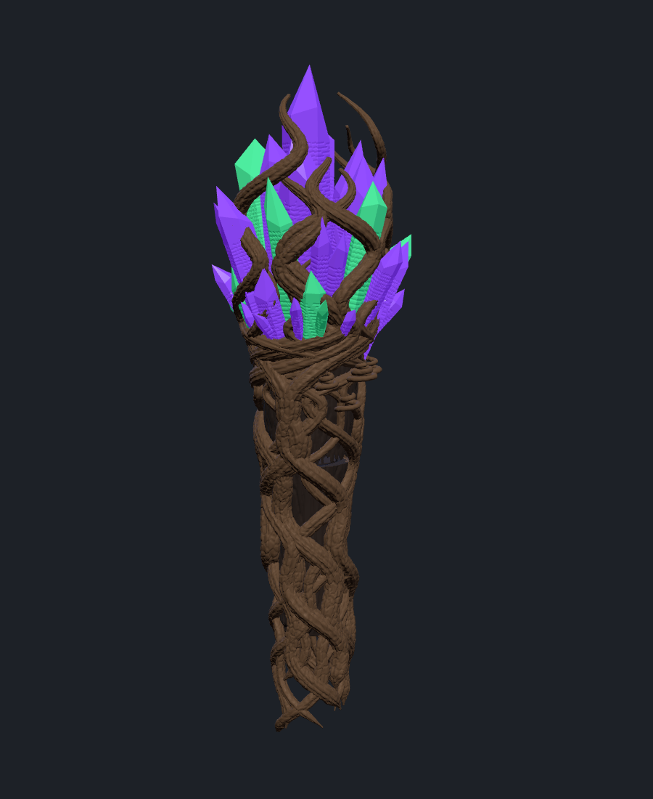
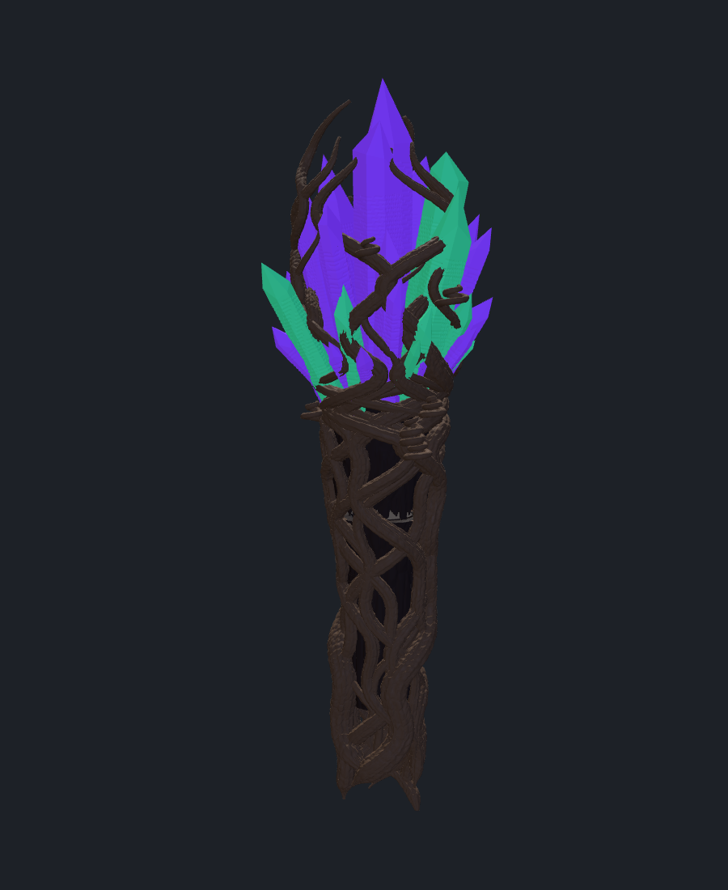
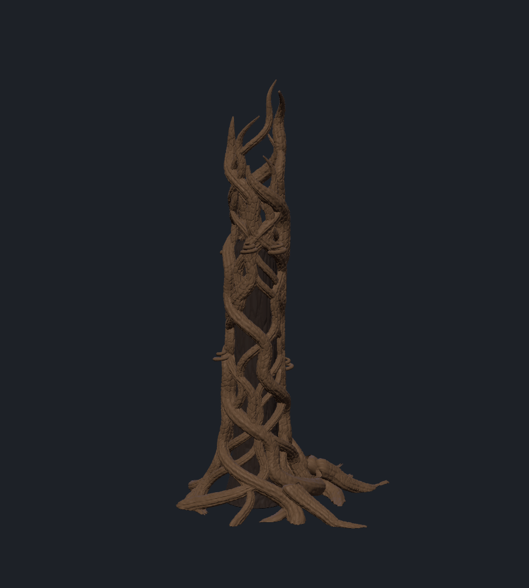
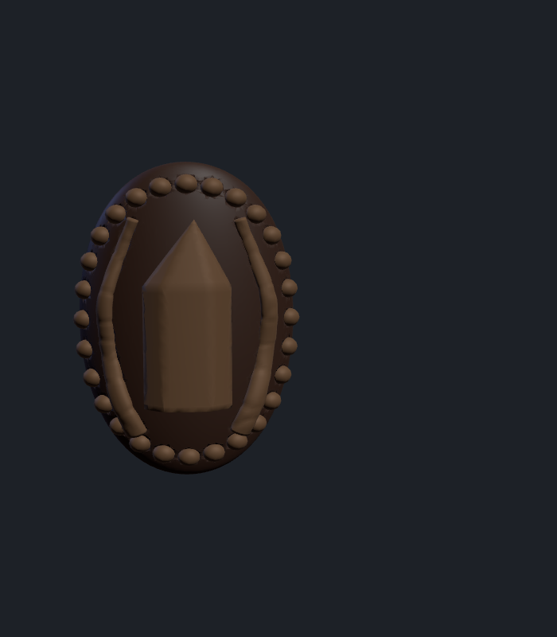
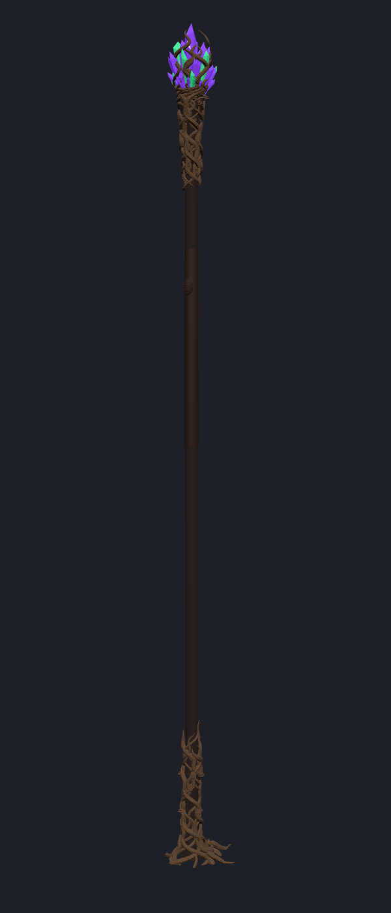

# Bâton hybride de la Guggen

Un **vrai manche en bois** au milieu, que tu entoures toi-même de ruban ou de cuir, une
**tête** et un **pied** imprimés en lianes tressées, et un **petit logo** à fixer sur le ruban.
Hauteur totale : **1,80 m**.

| Tête | Tête (dos) | Pied | Logo | Bâton monté |
|---|---|---|---|---|
|  |  |  |  |  |

## Les pièces

- **Tête** (94 × 90 × 333 mm) : 16 lianes tressées par paires, avec des fibres dans le sens
  de la liane et de petites gerçures, montent le long du manche, se resserrent sous le bouquet
  puis s'enroulent entre 42 cristaux (70 % violets, 30 % verts). Les cristaux ont des sections
  irrégulières, des pointes décentrées et des stries horizontales comme du vrai quartz.
  Des vrilles s'enroulent sur les lianes. Le manche entre de 90 mm ; une **bougie LED se pose
  sur le bout du manche**, sous les cristaux.
- **Pied** (162 × 174 × 317 mm) : 14 lianes qui grimpent sur le manche et s'écartent en
  racines au sol, plus 6 grosses racines. Large base, stable.
- **Logo** (24 × 34 mm) : médaillon ovale à bord perlé, cristal en relief entre deux lianes,
  dos incurvé pour épouser le manche + ruban.
- **Bague de test** : 15 mm de haut, pour vérifier l'ajustement sur ton manche avant tout.

## Fichiers (`stl/`) et têtes Prusa XL

| Pièce | Fichiers à charger ensemble | Têtes |
|---|---|---|
| Tête | `tete_bois` + `tete_lianes` + `tete_cristaux_violets` + `tete_cristaux_verts` | T1, T2, T3, T4 |
| Pied | `pied_bois` + `pied_lianes` | T1, T2 |
| Logo | `logo_fond` + `logo_motif_or` | T1 (ou T2), T5 |
| Test | `test_manche` | n'importe laquelle |

| Tête | Filament |
|---|---|
| T1 | PLA brun très foncé (fourreaux, fond du logo) |
| T2 | PLA brun bois, idéalement soie bronze / cuivre (lianes) |
| T3 | PLA ou PETG translucide violet |
| T4 | PLA ou PETG translucide vert |
| T5 | PLA soie or (motif du logo) |

Dans PrusaSlicer : sélectionner les fichiers d'une pièce, les glisser ensemble, « Oui » à
« objet à plusieurs parties », attribuer chaque partie à sa tête. Ne rien tourner ni redimensionner.

## À acheter

| Article | Détail |
|---|---|
| **Manche** | Rond de bois dur (hêtre ou frêne) **Ø28 mm**, 2 m, à couper à **1,60 m** |
| Teinte bois | Lasure / teinte noyer foncé pour le manche |
| Ruban / cuir | Ce que tu veux pour le milieu (le logo est prévu pour 1,5 mm d'épaisseur) |
| Bougie LED | Chauffe-plat Ø38 mm max, **blanche ou RGB avec télécommande** |
| Vis | 2 vis à bois 3,5 × 20 mm (une pour la tête, une pour le pied) |
| Colle | Époxy pour le pied (la tête reste démontable), colle contact pour le logo |
| Filaments | T2 : 1 bobine (≈ 450 g) · T1 : un reste (≈ 120 g) · T3 : ≈ 90 g · T4 : ≈ 35 g · T5 : quelques grammes |

> **Si ton manche ne fait pas exactement 28 mm**, change `DIAM_MANCHE` en haut de
> `generer.py` (ou dis-le à Claude) et relance : toutes les pièces s'adaptent.

## Réglages d'impression (Prusa XL 5T, buses 0,4 mm)

- **D'abord la bague de test** : le manche doit coulisser sans forcer et sans jeu. Sinon,
  ajuster `JEU` (0,5 mm par défaut) et relancer.
- Couches : **0,15 mm** pour la tête, **0,2 mm** pour le pied, **0,1 mm** pour le logo.
- 3 périmètres, gyroïde 10 %, jointure alignée.
- **Supports organiques partout** pour la tête et le pied (racines, lianes décollées, pointes crochues).
  Supports en T1, espace en Z 0,2 mm.
- **Cristaux** (réglage par partie) : 2 périmètres, **0 % de remplissage** : creux, ils
  diffusent la lumière.
- Bordure 5 mm pour la tête (haute et étroite à la base).
- Logo : face vers le haut, supports organiques sous le dos incurvé.
- Temps : ≈ 25-35 h pour la tête, 20-25 h pour le pied.

## Montage

1. Couper le manche à 1,60 m, le teinter.
2. Enfoncer le pied (12 mm de bois sous le manche), coller à l'époxy, visser par le trou latéral.
3. Enrouler le ruban au milieu, coller le logo dessus.
4. Poser la bougie LED sur le bout du manche, enfiler la tête, visser par le trou latéral
   (pas de colle : on dévisse pour changer la pile).

## Finition

Un jus brun-noir très dilué sur les lianes, essuyé tout de suite, fait ressortir les fibres et
les gerçures ; un brossage à sec beige léger sur les reliefs. Vernis mat, en masquant les cristaux.
